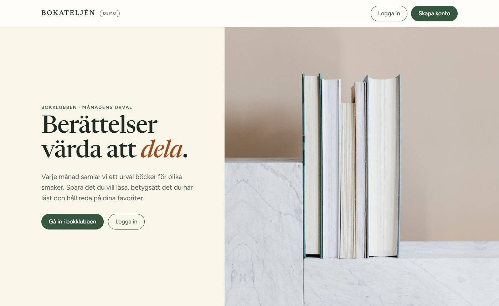
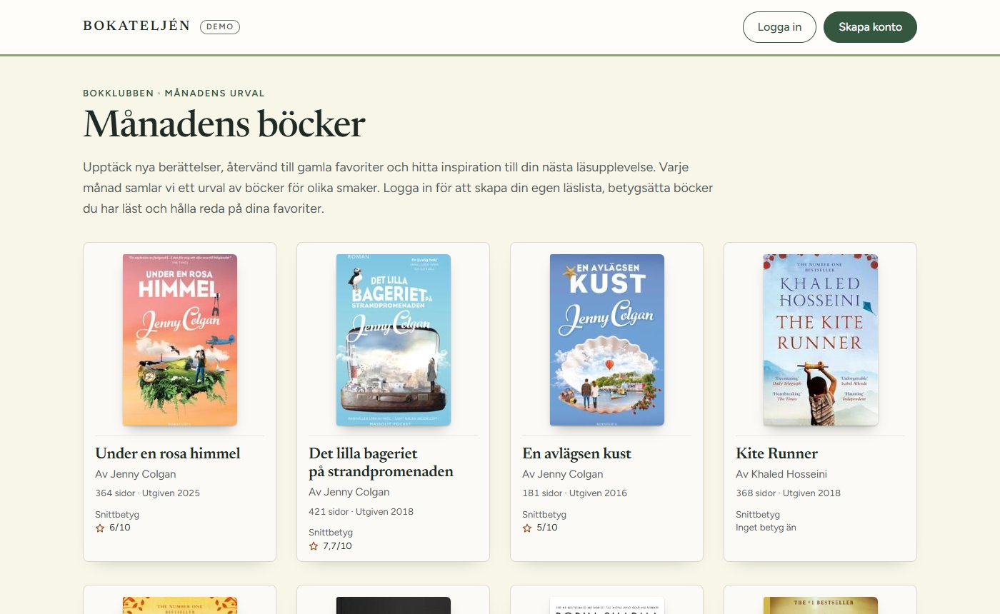
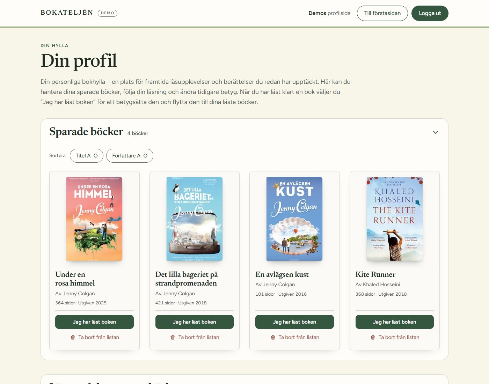

# 📚 Bokateljén

En liten bokklubb där du kan bläddra bland månadens böcker, spara dem du vill läsa och betygsätta dem du har läst.

🌐 **[Testa live-demon](https://bokshoppen-strapi.netlify.app/)** (inget konto eller installation behövs)



| Katalogen | Min profil |
| :---: | :---: |
|  |  |

## Om projektet

Projektet började som en skoluppgift om att använda ett **headless CMS** (Strapi) som backend till en egen frontend. Därefter har jag vidareutvecklat det med ny design, återanvändbara komponenter och säkrare hantering av data från API:et.

I Strapi lägger administratören in böcker och väljer årstidstema. Besökare kan skapa konto, spara böcker och sätta betyg.

## Funktioner

- 📖 **Bokkatalog** med omslag, författare, sidantal, utgivningsår och snittbetyg
- 🔐 **Konto:** registrera dig eller logga in, från landningssidan eller katalogen
- 🔖 **Spara bok:** samla böcker som du vill läsa
- ⭐ **Jag har läst boken:** välj ett betyg (1–10) så flyttas boken till dina lästa böcker. En bok är antingen sparad eller läst, aldrig båda.
- 👤 **Min profil:** ändra eller ta bort betyg, ta bort sparade böcker och sortera efter titel, författare eller (för lästa böcker) högsta betyg
- 🎨 **Årstidsteman:** vår, sommar och höst

## 🚀 Prova demon

1. Öppna [live-demon](https://bokshoppen-strapi.netlify.app/).
2. Klicka på **Logga in** och sedan **Prova demokontot**.
3. Klicka på **Spara bok** på en bok.
4. Klicka på **Jag har läst boken** på en annan, välj ett betyg och klicka på **Spara**.
5. Öppna **Min profil** och sortera dina böcker.
6. Byt tema längst ned på sidan.

Demon körs utan Strapi. Den har en fast katalog, och det du sparar finns bara i din egen webbläsare.

## 🛠️ Tech stack

| Del                  | Teknik                                 |
| -------------------- | -------------------------------------- |
| Frontend             | HTML, SCSS och JavaScript (ES-moduler) |
| Backend och CMS      | Strapi 5 med SQLite                    |
| Bibliotek (via CDN)  | axios, jQuery och Toastr               |
| Publicering av demon | Netlify                                |

## 💻 Köra projektet lokalt

Börja med att hämta koden:

```bash
git clone https://github.com/NathalieBruno/bokshoppen-strapi.git
cd bokshoppen-strapi
```

Frontend behöver en lokal webbserver, till exempel tillägget **Live Server** i VS Code. Det går inte att öppna HTML-filerna direkt från datorn.

Du kan sedan köra projektet på två sätt.

### Alternativ A: utan Strapi (snabbast)

Starta Live Server på `frontend/index.html` och lägg till `?demo=1` sist i adressen. Då körs samma demoläge som i live-demon.

### Alternativ B: med Strapi

Du behöver [Node.js](https://nodejs.org) 18–22.

**1. Starta Strapi**

```bash
cd backend
cp .env.example .env    # byt ut exempelvärdena mot egna hemliga nycklar
npm install
npm run develop
```

Strapi startar på `http://localhost:1337/admin`. Första gången får du skapa ett adminkonto.

**2. Ge rollerna behörigheter**

Gå till **Settings → Users & Permissions plugin → Roles** och kryssa i följande:

| Innehållstyp  | Public | Authenticated                        |
| ------------- | ------ | ------------------------------------ |
| Book          | `find` | `find`                               |
| Theme Setting | `find` | `find`                               |
| Rating        | `find` | `find`, `create`, `update`, `delete` |
| Wishlist      | –      | `find`, `create`, `delete`           |

Kontrollera också att `Authenticated` får använda `me` under **Users-permissions → User**.

**3. Lägg in innehåll**

Gå till **Content Manager**:

- **Book:** lägg till böcker med titel, författare, sidantal, utgivningsdatum och omslag. Klicka på **Publish**.
- **Theme Setting:** slå på `IsSpring` för vår eller `IsAutumn` för höst. Annars visas sommartemat. Klicka på **Publish**.

**4. Starta frontend**

Starta Live Server på `frontend/index.html`. Har du tidigare använt `?demo=1` i samma flik lägger du till `?demo=0` för att byta tillbaka till Strapi.

### Ändra stilarna

Du behöver bara det här steget om du ändrar i SCSS-filerna. Webbläsaren läser den kompilerade filen `style.css`, så kompilera om efter varje ändring:

```bash
npx sass frontend/style/style.scss frontend/style/style.css
```

## 📁 Struktur

```
bokshoppen-strapi/
├── backend/            Strapi CMS (böcker, betyg, sparade böcker, tema)
├── frontend/           Webbplatsen
│   ├── welcome.html    Landningssida
│   ├── index.html      Katalogen med månadens böcker
│   ├── index.js        Logik för katalogen
│   ├── login.js        Inloggning, registrering och användarknappar i sidhuvudet
│   ├── api.js          Anrop mot Strapi och demoläge
│   ├── theme.js        Årstidsteman
│   ├── dom.js          Hjälpfunktion för att säkert bygga HTML-element
│   ├── toast.js        Gemensamma inställningar för notiser
│   ├── user/           Profilsidan (HTML och logik)
│   ├── components/     Återanvändbara delar (bokkort, betyg, dialoger, ikoner, sidfot, formulärfel)
│   ├── style/          SCSS uppdelat i flera filer, kompileras till style.css
│   ├── images/         Foto till landningssidan
│   └── demo/           Bokdata och omslag för demon
└── netlify.toml        Netlify-inställningar (visar landningssidan på startadressen)
```
